<p align="center">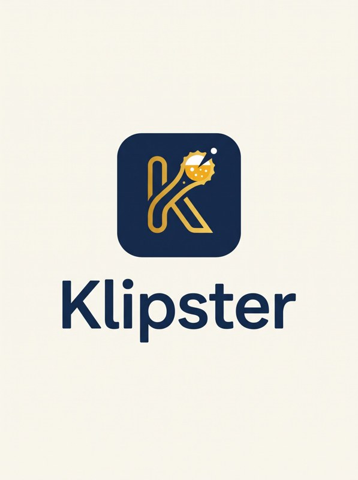</p>

# Klipster

Digitalt klippekort til barer i Danmark. Her er det samlede materiale: forretningskoncept og marketingplan, konceptbilleder af appen og en blueprint til Claude Code.

> Konceptmateriale. Priser, mål og datoer er forslag. Billederne er konceptdesign med eksempeldata, ikke skærmbilleder fra den færdige app.

**Indhold**

1. [Forretningskoncept og marketingplan](#1-forretningskoncept-og-marketingplan)
2. [Appen i billeder](#2-appen-i-billeder)
3. [Blueprint til Claude Code](#3-blueprint-til-claude-code)

---

## 1. Forretningskoncept og marketingplan

### Kort fortalt

Klipster flytter barens klippekort fra papir ind i telefonen. Baren betaler et fast månedligt abonnement, og gæsterne bruger appen gratis. Vi starter med 5–10 pilotbarer i én studieby og udruller derefter by for by.

- **Hvad:** Et digitalt klippekort til barer. Gæsten køber kortet i baren, og personalet lægger det i walleten ved at scanne gæstens QR-kode. Når gæsten vil bruge klip, vælger gæsten antallet, og personalet godkender.
- **Hvem betaler:** Barerne. Gæsterne bruger Klipster gratis.
- **Værdi for baren:** Forudbetalt salg, flere genbesøg, intet snyd med stempler og viden om, hvem stamgæsterne er.
- **Værdi for gæsten:** Kortet ligger altid i lommen, kan ikke blive væk, og alle barens kort er samlet ét sted.
- **Første mål:** 10 aktive barer og et bevis på, at de vil betale, inden for de første 6 måneder.

Priser, mål og budget er forslag og antagelser. Markedet og konkurrenterne er ikke undersøgt endnu, så tallene skal testes med rigtige barer.

### Problemet og løsningen

Papirklippekort koster baren penge og data, og de irriterer gæsten. Klipster løser begge dele uden at gøre det langsommere at servere.

**For baren**

- Kortene kan forfalskes eller stemples ekstra, og ingen opdager det.
- Baren ved ikke, hvem stamgæsterne er, og kan ikke kontakte dem.
- Der er intet overblik over, hvor mange klip der er solgt, men endnu ikke brugt.

**For gæsten**

- Kortet ligger derhjemme eller er gået i vaskemaskinen.
- Har man kort til flere barer, mister man overblikket.

**Sådan virker Klipster**

1. Baren opretter sit klippekort, fx 10 fadøl til prisen af 8.
2. Gæsten køber kortet i baren og betaler ved kassen, som de plejer.
3. Personalet scanner gæstens QR-kode i personale-appen og lægger kortet i walleten.
4. Ved næste bestilling vælger gæsten antal klip i appen og viser QR-koden. Personalet scanner og godkender, men kan ikke ændre antallet.
5. Saldoen opdateres med det samme hos begge, og baren følger salget i sit dashboard.

Køb direkte i appen kommer i en senere fase. Ved at starte i baren slipper vi for betalingsløsning og gebyrer i piloten.

### Målgrupper

Vi starter med barer i studiebyer. De sælger allerede klippekort, deres gæster lever på telefonen, og næste bar ligger 50 meter væk.

| Segment | Hvem | Hvad de vil have | Prioritet |
| --- | --- | --- | --- |
| Studenterbarer og barer ved campus | Ejere og bestyrere, ofte unge | Fyldt bar på hverdage, billig markedsføring | 1 (start her) |
| Fredagsbarer på uddannelser | Frivillige studenterforeninger | Slippe for papirkort og kontanthåndtering | 1 (start her) |
| Ølbarer og specialbarer | Ejere med fokus på stamgæster | Loyalitet og kendskab til gæsterne | 2 |
| Bodegaer og værtshuse | Ejere med ældre, faste gæster | Enkelt system, intet bøvl | 3 (kræver mere hjælp) |
| Natklubber | Kæder og større steder | Hurtighed i køen, forudsalg | 3 (senere) |

**Gæsterne** er primært 18–30 år, prisbevidste og vant til at betale med telefonen. De vælger bar efter vennerne og efter, hvor deres kort gælder.

### Forretningsmodel og priser

Anbefalingen er et fast månedligt abonnement pr. bar og ingen procentdel af salget. Det er let at forklare i baren og nemt at budgettere for ejeren. Priserne er forslag, der skal testes med pilotbarerne.

| Pakke | Pris (forslag, ekskl. moms) | Indhold |
| --- | --- | --- |
| Pilot | 0 kr. i 3 måneder | Alt i Start mod feedback og ret til at bruge baren som case |
| Start | 299 kr./md. | Ét klippekort, personale-app, dashboard med salg |
| Pro | 599 kr./md. | Flere korttyper, kampagner, eksport og flere lokationer |

**Alternativet**, en procentdel af klippekortsalget (fx 2–3 %), skalerer med baren. Til gengæld føles det som en skat på deres eget salg, og det er sværere at sælge. Det kan blive relevant for store natklubber senere.

**Betaling:** I starten betaler gæsten i barens egen kasse. Klipster rører ikke pengene, og baren har ingen ekstra gebyrer. Når køb i appen kommer, skal det afklares, hvem der betaler betalingsudbyderens gebyr.

**Regnestykke:** 100 barer × 399 kr./md. i gennemsnit giver 39.900 kr./md., svarende til ca. 479.000 kr./år før omkostninger.

### Konkurrence og positionering

Klipsters plads er at være det eneste klippekort, der er bygget til baren: forudbetalte klip, ikke point. Den største konkurrent er papirkortet. Konkrete konkurrerende apps er ikke undersøgt endnu, så det er første opgave.

| Alternativ | Styrke | Svaghed, som Klipster rammer |
| --- | --- | --- |
| Papirklippekort (status quo) | Gratis og kendt af alle | Snyd, bliver væk, ingen data |
| Generiske stempel- og pointapps | Mange funktioner | Ikke bygget til forudbetalte klip eller travlhed i baren |
| Kassesystemets loyalitetsmodul | Allerede installeret | Ofte omstændeligt, og gæsten har intet samlet overblik |
| Barens egen app | Fuld kontrol | Dyrt at bygge, og ingen gæster henter en app til én bar |

**Positionering:** For barer, der sælger klippekort, er Klipster det digitale klippekort, der klipper på to sekunder i travlheden. I modsætning til pointapps handler det om forudbetalt salg, som baren får penge for med det samme.

### Brand og budskaber

Klipster skal føles som en kammerat i baren, ikke som et betalingssystem. Navnet blander "klip" med en legende endelse, og logoet i navy og guld med ølkapslen i K'et signalerer bar og kvalitet.

- **Tone:** Uformel, dansk og lidt kæk. Kort tekst. Aldrig belærende, og aldrig opfordring til at drikke mere.
- **Slogan, forslag:** "Klip. Skål. Gentag." Alternativer: "Dit klippekort er flyttet ind i telefonen" og "Altid et klip på lommen".
- **Farver:** Navy som basis, guld som accent og lys crème som baggrund, som i logoet. Appen bruger i dag blå som accentfarve.

| Til | Budskab | Bevis vi skal kunne vise |
| --- | --- | --- |
| Baren | Få pengene før gæsten drikker | Forudbetalt salg pr. måned i dashboardet |
| Baren | Slut med snyd og tabte kort | Hvert klip er logget med tid og medarbejder |
| Baren | Kend dine stamgæster | Liste over de mest aktive gæster |
| Gæsten | Dit kort kan ikke blive væk | Kortet ligger i appen, også på ny telefon |
| Gæsten | Alle dine barer ét sted | Oversigt over kort og klip tilbage |
| Gæsten | Hurtigere i baren | Vis koden, få et klip, færdig |

Beviserne forudsætter funktioner, der ikke er bekræftet i koden endnu. Tjek, at de findes, før de bruges i markedsføringen.

### Go-to-market

Vi vinder én by før den næste. Klipster er mest værd for gæsten, når mange barer i samme område bruger det, og det kræver, at man står tæt.

**Valg af pilotby:** En studieby, hvor vi har netværk, fx Aarhus, Odense eller Aalborg. Netværket betyder mere end byens størrelse.

**Salget til baren, trin for trin**

1. Besøg baren om eftermiddagen, hvor ejeren har tid. Aldrig fredag aften.
2. Vis det på din egen telefon: personalet lægger et kort i din wallet og klipper på under et minut.
3. Tilbyd 3 gratis måneder mod feedback og ret til at bruge baren som case.
4. Opsæt baren på stedet på 15 minutter: klippekort, personale-login og skilte.
5. Kom igen efter en uge og tjek, at personalet klipper uden problemer.

**Startpakke til hver bar:** QR-skilt til baren, bordkort, ølbrikker med QR-kode og en kort guide til personalet.

**Lanceringstilbud til gæster:** Det første kort giver et ekstra klip, fx 11 for 10. Det koster baren lidt og giver en grund til at hente appen i dag.

### Marketingkanaler og aktiviteter

Barerne vindes ved personlig kontakt, og gæsterne vindes i baren. Betalt annoncering venter, til vi ved, hvilket budskab der virker.

**Barer (B2B)**

| Kanal | Aktivitet | Hvorfor |
| --- | --- | --- |
| Direkte besøg | Demo på telefonen og opsætning på stedet | Ejere køber af folk, de har mødt |
| Henvisninger | En gratis måned for hver bar, de skaffer | Bar-ejere kender hinanden |
| Bryggerier og grossister | Partnerskab, hvor de anbefaler Klipster til deres barer | De besøger allerede barerne hver uge |
| Cases | Korte videoer med pilotbarerne: før og efter | Bevis fra en kollega slår enhver brochure |
| Bar-ejergrupper på Facebook og LinkedIn | Opslag med cases og tilbud | Billig og målrettet |

**Gæster (B2C)**

| Kanal | Aktivitet | Hvorfor |
| --- | --- | --- |
| I baren | QR på skilte, bordkort og ølbrikker, og personalet nævner det | Gæsten er allerede klar til at købe |
| Lanceringstilbud | Ekstra klip på første kort | Grund til at hente appen nu |
| TikTok og Instagram | Korte klip fra barerne, gerne lavet af barerne selv | Der er målgruppen |
| Studenterforeninger | Samarbejde med fredagsbarer og fester | Mange gæster på én gang |
| Del med en ven | Giv en ven et klip, få et selv | Vennerne vælger baren sammen |

Al markedsføring skal overholde de danske regler for alkoholreklame, se risici.

### Budget og nøgletal

Piloten koster mest tid og kun lidt kontanter: tryksager, ølbrikker og lanceringsklip. Beløbene sættes, når der er indhentet tilbud på tryk.

**Budgetposter i rækkefølge**

1. Startpakker til barerne: skilte, bordkort og ølbrikker med QR.
2. Lanceringsklip: ekstra klip, som Klipster eventuelt betaler for i piloten.
3. Video til cases: ofte nok med en telefon og en eftermiddag.
4. Betalt annoncering: først efter piloten, i små tests.

| Nøgletal | Hvad det viser | Mål efter piloten (forslag) |
| --- | --- | --- |
| Aktive barer | Barer med mindst ét klip om ugen | 10 |
| Pilotbarer der vil betale | Om produktet er pengene værd | Mindst 5 af 10 |
| Solgte kort pr. bar pr. måned | Om gæsterne tager det til sig | Sættes efter de første 4 uger |
| Digital andel af barens klippekort | Om papirkortet bliver erstattet | Over 50 % |
| Tid fra besøg til første klip | Hvor let opstarten er | Under 1 dag |
| Barer der opsiger | Om de bliver | 0 i piloten |

### Køreplan

Vi udvider først, når piloten har vist, at barerne vil betale. Piloten starter i februar 2027, så den falder sammen med semesterstart.

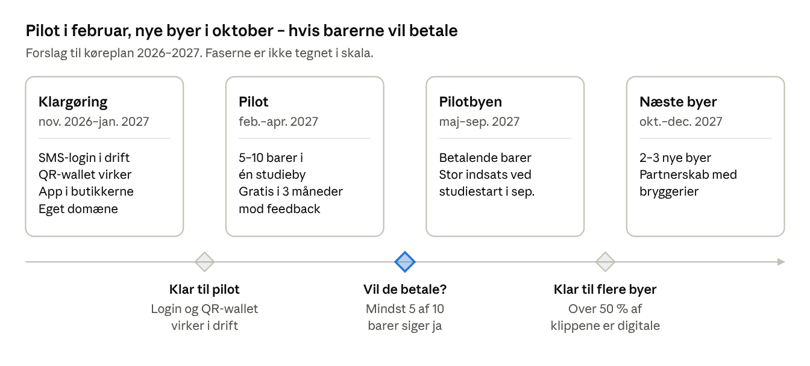

Siger færre end 5 af 10 pilotbarer ja til at betale, justerer vi pris eller produkt og forlænger piloten i stedet for at udvide.

### Risici og åbne spørgsmål

I starten betaler gæsten i barens egen kasse, så Klipster rører ikke pengene. Det udskyder den største juridiske risiko: holder Klipster senere selv pengene ved køb i appen, kan det kræve en tilladelse fra Finanstilsynet. Det er ikke juridisk rådgivning; få det bekræftet af en advokat eller revisor.

| Risiko | Hvad kan ske | Hvad vi gør |
| --- | --- | --- |
| Pengestrøm | Krav om tilladelse, hvis Klipster holder gæsternes penge | Ingen i starten, da gæsten betaler i barens kasse. Ved køb i appen: betaling direkte til baren, vurderet juridisk |
| Baren lukker | Gæster mister ubrugte klip | Klare vilkår for gyldighed og refusion i baraftalen |
| Alkoholreklame | Kritik eller klager over markedsføringen | Følg de danske regler: ingen under 18 år, ingen opfordring til at drikke mere |
| Persondata (GDPR) | Telefonnumre og købsvaner er persondata | Privatlivspolitik og databehandleraftale med hver bar |
| Personalet dropper det | Klip bliver glemt i travlheden | Klip under 2 sek., kort i walleten under 15 sek., og personalet trænes ved opstart |
| Moms og regnskab | Uklart hvornår moms skal betales af forudbetalte klip | Afklar med revisor før første betalende bar |
| Personalet lægger kort i uden betaling | Gratis kort til venner, tab for baren | Log hvert kort med medarbejder og tid, og afstem mod kassen |
| Forkert antal klip trækkes | Gæsten mister klip og klager | Gæsten vælger antallet, og personalet kan kun godkende eller afvise |

**Åbne spørgsmål**

- [ ] Besluttet: personalet finder walleten ved at scanne gæstens QR-kode.
- [ ] Hvornår skal køb i appen komme, og hvem modtager så pengene?
- [ ] Er "Klipster" ledigt som varemærke, domæne og app-navn?
- [ ] Hvilken by er pilotbyen, og hvem kender vi der?
- [ ] Passer planen til `PLAN.md` i koden?
- [ ] Hvornår er SMS-login klar til at erstatte testlogin?

---

## 2. Appen i billeder

Klipster består af tre dele: gæste-appen, personale-appen og barens dashboard. Billederne følger appens nuværende design med hvid baggrund, sorte overskrifter og blå accent. Skærme mærket "Planlagt" findes ikke endnu, og alle navne, barer og tal er eksempeldata.

**Gæste-appen:** Kortene vist som rigtige klippekort med bar og navn, vælg antal klip og vis QR-koden (planlagt) og historik over købt, optanket, brugt og gratis klip.

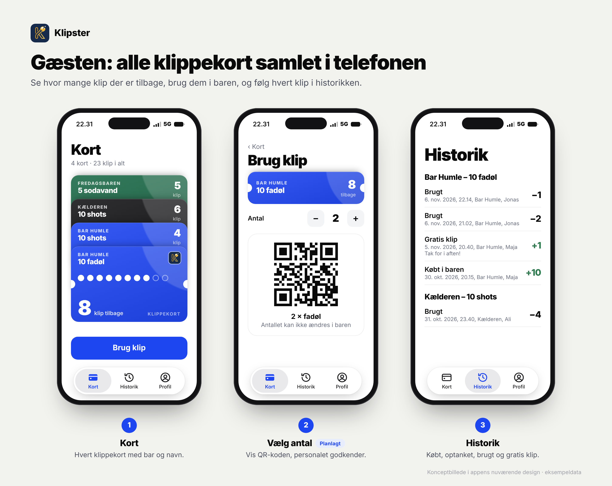

**Personale-appen:** Scan gæstens QR-kode, godkend det antal klip, gæsten har valgt, og få en bekræftelse (planlagt). Bartenderen kan ikke ændre antallet. Købt i baren, optank og gratis klip registreres stadig af personalet.

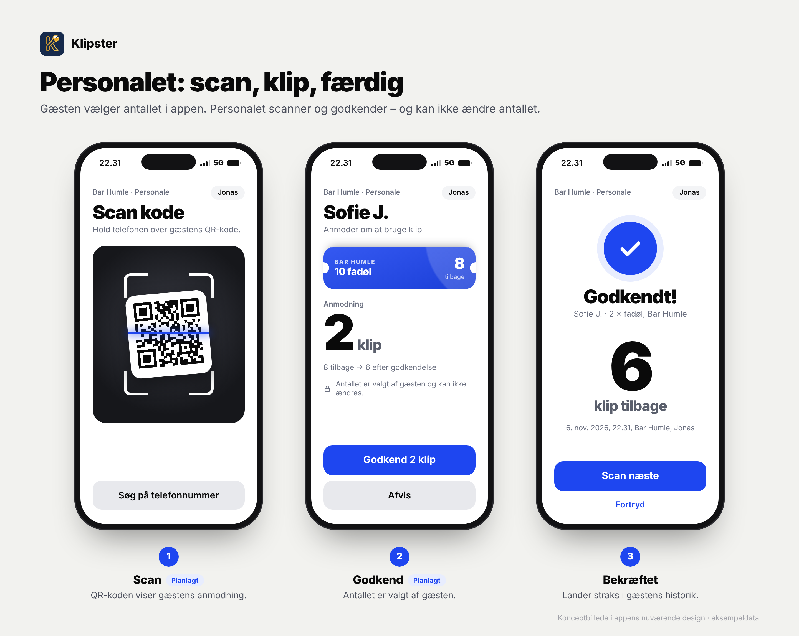

**Barens dashboard:** Salg, brugte klip, ubrugte klip, afstemning mod kassen og stamgæster.

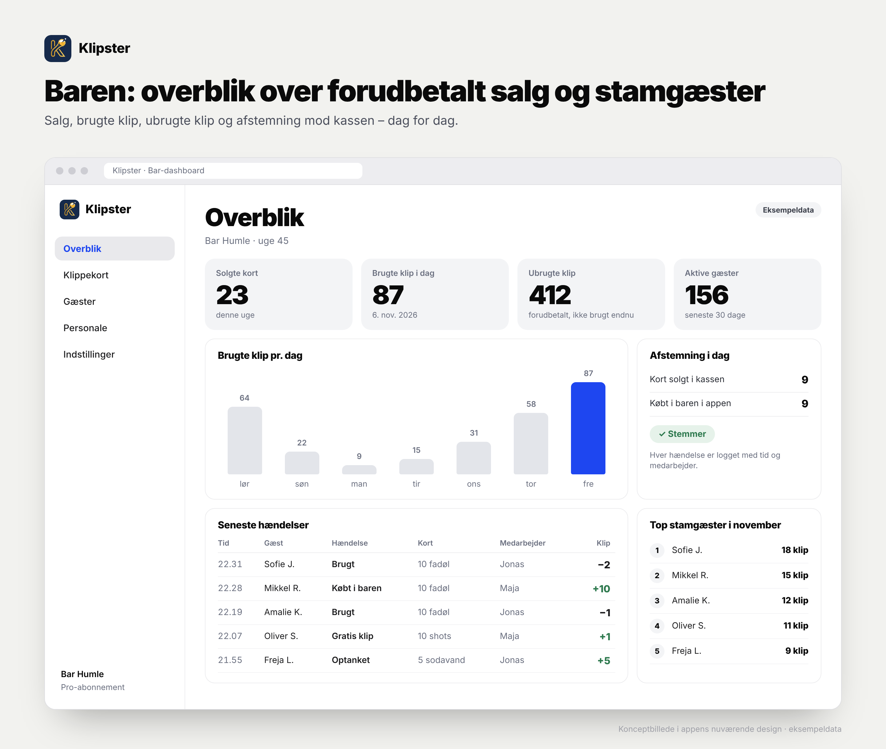

---

## 3. Blueprint til Claude Code

> **Sådan bruger du afsnittet**
> 1. Kopiér hele mappen `klipster/` (denne README og mappen `design/`) ind i `klippekort`-repoet som `docs/klipster/`.
> 2. Åbn `klippekort` i VS Code, start Claude Code og skriv:
>
> ```
> Læs afsnit 3 "Blueprint til Claude Code" i docs/klipster/README.md og se skærmbillederne i docs/klipster/design/. Udfør Fase 0. Stop derefter og vent på mig.
> ```
>
> 3. Tag én fase ad gangen. Når en fase er godkendt, skriv fx: `Fase 0 er godkendt. Udfør Fase 1.`
>
> Stier til skærmbilleder i dette afsnit er relative til denne README (`design/...`).

### 3.1 Kontekst

Klipster (repo: `klippekort`) er et digitalt klippekort til barer i Danmark.

npm-workspaces-monorepo, Node >= 22.12:

- `apps/api` – API og worker, kører i Docker, PostgreSQL 18
- `apps/mobile` – Expo (Expo Router i `src/app`, React Compiler) med gæste- og personaledel
- `apps/web` – bar-dashboard (SPA, serveres af Caddy)
- `packages/*` – delt kode
- `infra/` – docker-compose, Caddyfile (`/v1/*`, `/healthz`, `/readyz` → `api:3000`), backup

Appens API-adresse styres af `EXPO_PUBLIC_API_URL` (`apps/mobile/src/lib/config.ts`).

Gæste-appen har i dag fanerne **Kort**, **Historik** og **Profil**. Historikken har hændelserne **Optanket**, **Købt i baren**, **Brugt** og **Gratis klip** (med besked). Login er et midlertidigt udviklingslogin ("Vælg testkonto"), som senere erstattes af SMS- og adgangskodelogin.

### 3.2 Arbejdsregler

1. Læs først `CLAUDE.md`, `AGENTS.md`, `PLAN.md`, `README.md` og `CHANGELOG.md` i `klippekort`, og følg dem. Strider de mod denne blueprint, så spørg mig.
2. Planlæg, før du koder. Vis planen og vent på mit "ok" før større ændringer.
3. Én fase ad gangen. Små, sammenhængende commits med klare beskeder. Opdatér `CHANGELOG.md`.
4. Kør `npm run lint`, `npm run typecheck` og `npm test`, før du melder en fase færdig. Skriv tests for alle forretningsregler i 3.3.
5. Databaseændringer kun via migrationer (`npm run db:migrate`). De skal kunne køre på en database med eksisterende data. Ingen sletning af data uden at spørge.
6. Rør ikke `infra/.env`, hemmeligheder, bundle identifier/package name eller produktionsserveren uden at spørge.
7. Al tekst i brugerfladen er på dansk. Følg det eksisterende design (3.5).
8. Er du i tvivl om den eksisterende kode eller datamodel, så spørg i stedet for at gætte.
9. Åbn og se det tilhørende skærmbillede i `design/`, før du bygger en skærm. Når skærmen er bygget, så sammenlign den med skærmbilledet og nævn forskellene i din rapport.

### 3.3 Forretningsregler

Reglerne skal håndhæves i API'et, ikke kun i appen.

| # | Regel |
| --- | --- |
| R1 | **Køb sker i baren.** Gæsten betaler i barens kasse. Ingen betaling i appen i denne version. |
| R2 | **Kort i walleten.** Personalet scanner gæstens wallet-QR og vælger "Købt i baren" og et produkt. Kortet oprettes med produktets antal klip. |
| R3 | **Gæsten vælger antallet.** Kun gæsten kan oprette en anmodning om at bruge klip: kort + antal, hvor 1 <= antal <= saldo. |
| R4 | **Personalet kan kun godkende eller afvise.** Godkend-endpointet tager ikke imod et antal; antallet læses fra anmodningen. Personalet kan aldrig ændre antallet. |
| R5 | **Anmodninger** har en ugættelig token i QR-koden (ikke et bruger-ID), kan kun bruges én gang, udløber efter fx 5 minutter (konfigurerbart) og kan kun godkendes af personale fra den bar, kortet hører til. |
| R6 | **Sikker saldo.** Godkendelse sker i én databasetransaktion med lås. Saldoen kan aldrig blive negativ. Gentagne kald (dobbelttryk, netværksfejl) må ikke trække to gange. |
| R7 | **Alt logges.** Hver hændelse gemmes med tidspunkt, bar, kort, gæst, medarbejder og antal. Typer: købt i baren, optanket, brugt, gratis klip (med besked), afvist, fortrudt. Hændelser slettes aldrig. |
| R8 | **Fortryd.** Den medarbejder, der godkendte, kan fortryde inden for fx 60 sekunder. Fortryd opretter en modpostering og sletter intet. |
| R9 | **Flere produkter.** Hver bar har et produktkatalog: navn, antal klip, pris (kun information), farve, aktiv/inaktiv. En gæst kan have flere kort hos samme bar. |
| R10 | **Wallet-QR** identificerer gæsten over for personalet (til Købt i baren, Optank og Gratis klip). Den kan ikke i sig selv trække klip. |

### 3.4 Faser

#### Fase 0 – Kortlægning (ingen kodeændringer)

Lever en kort rapport om:

- nuværende datamodel: tabeller og relationer for bar, kort, gæst, medarbejder og hændelser
- relevante API-endpoints, og hvordan auth og roller (gæst/personale/bar) virker
- skærme i `apps/mobile` og `apps/web`
- om og hvordan realtid (WebSocket) bruges i dag
- hvordan tests køres, og hvordan der deployes til serveren (`infra/`)

Sammenlign med 3.3 og list, hvad der allerede findes, hvad der mangler, og hvad der strider mod reglerne. Foreslå derefter en konkret plan for Fase 1–5, tilpasset koden.

#### Fase 1 – Datamodel og API

- Produktkatalog pr. bar, inklusive farve (R9).
- Anmodninger om at bruge klip (R3–R6) med endpoints til at oprette (gæst), hente status (gæst), slå op via token (personale), godkende, afvise og fortryde (R8).
- Wallet-QR-token pr. gæst (R10).
- Hændelser jf. R7.
- Tests for alle regler, også to samtidige godkendelser af samme anmodning og udløbne anmodninger.

**Færdig når:** alle tests er grønne, godkend-kaldet ikke har et antal, og negativ saldo er umulig.

#### Fase 2 – Gæste-app

Skærmbilleder: `design/gaest-1-kort.png`, `design/gaest-2-brug-klip.png`, `design/gaest-3-historik.png`

<p>
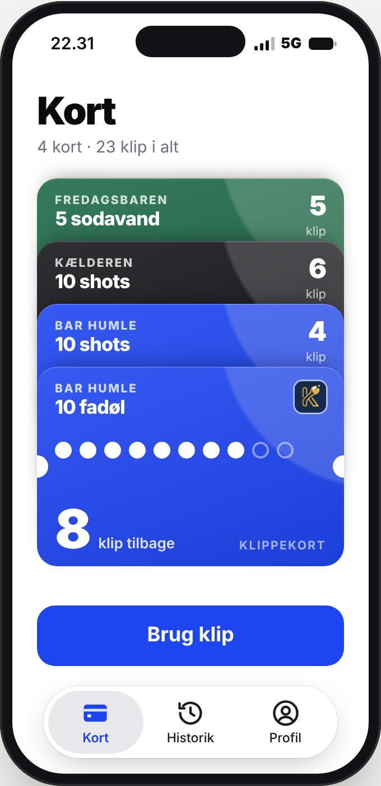
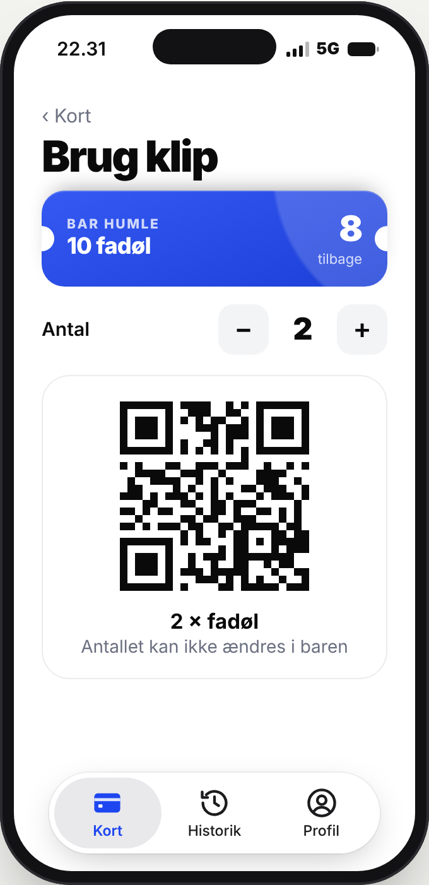
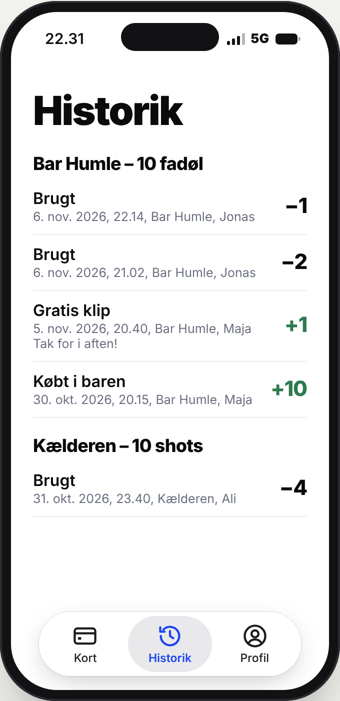
</p>

- **`KlippeKort`-komponent**, der ligner et fysisk kort: barens navn (små versaler), kortets navn (fed), klip tilbage, en prik pr. klip (brugt/ubrugt), barens farve, små hak i siderne og Klipster-logoet.
- **Kort-fanen:** kortene i en wallet-stak grupperet efter bar. Det valgte kort vises helt, de andre som toppe med bar, navn og klip tilbage. Tomme kort skjules og ses kun i historikken.
- **Brug klip:** vælg kort og antal (stepper 1…saldo) → skærm med QR-kode, "2 × fadøl" og teksten "Antallet kan ikke ændres i baren" → status live: venter, godkendt, afvist eller udløbet. Ved godkendelse opdateres saldoen, og der vises en bekræftelse.
- **Historik:** grupperet pr. kort, også med afvist og fortrudt.
- **Min kode:** gæstens wallet-QR, så personalet kan lægge kort i.

#### Fase 3 – Personale-app

Skærmbilleder: `design/personale-1-scan.png`, `design/personale-2-godkend.png`, `design/personale-3-bekraeftet.png`

<p>
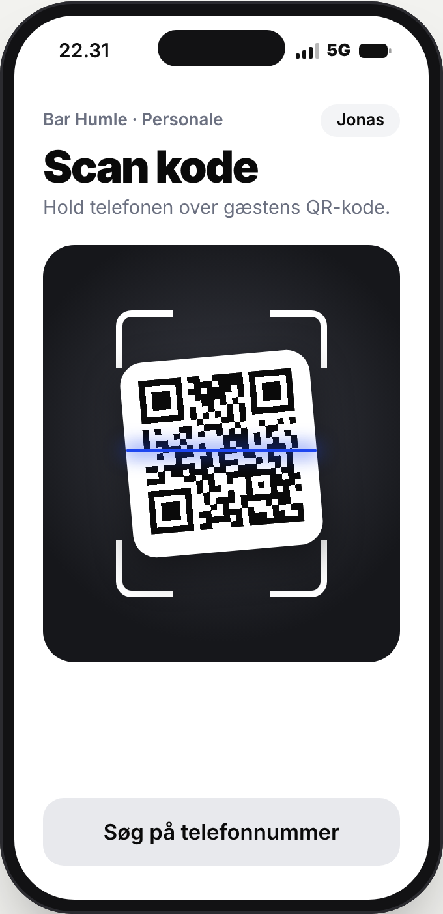
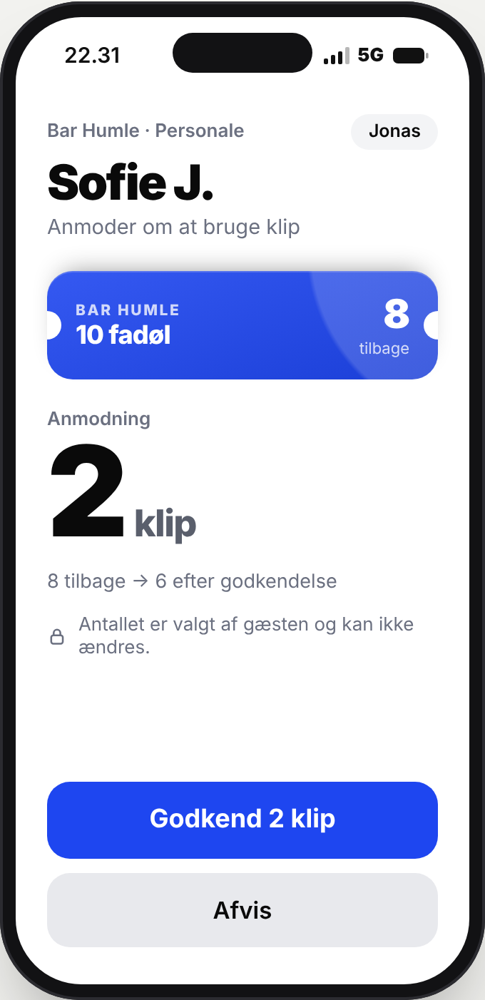
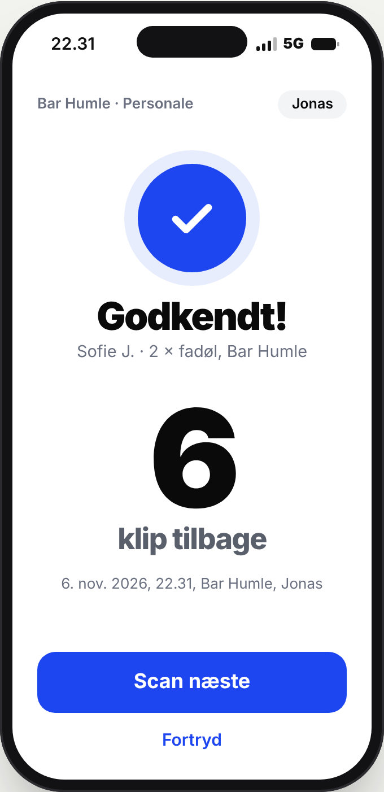
</p>

- **Scan** med kameraet og en reserveknap: "Søg på telefonnummer".
- **Anmodning scannet:** gæstens navn, kortet (lille `KlippeKort`), stort antal, "8 tilbage → 6 efter godkendelse", lås-teksten "Antallet er valgt af gæsten og kan ikke ændres" og knapperne **Godkend N klip** og **Afvis**. Ingen +/- knapper.
- **Bekræftet:** klip tilbage, tidspunkt og medarbejder, knappen **Scan næste** og **Fortryd** (R8).
- **Wallet-QR scannet:** handlingerne Købt i baren (vælg produkt), Optank og Gratis klip (med besked) med advarslen "Læg kun kort i, når det er betalt i kassen."

#### Fase 4 – Bar-dashboard (`apps/web`)

Skærmbillede: `design/dashboard-overblik.png`

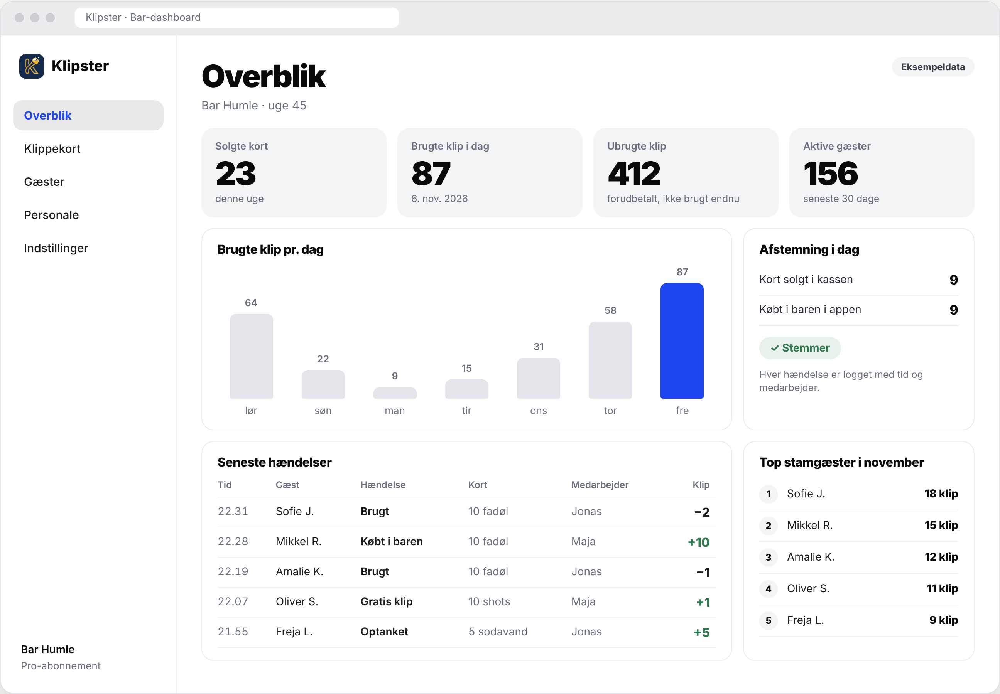

- **Overblik:** solgte kort (uge), brugte klip i dag, ubrugte klip (forudbetalt), aktive gæster (30 dage), brugte klip pr. dag (7 dage), seneste hændelser og top stamgæster.
- **Afstemning:** antal kort lagt i pr. dag og pr. medarbejder, så baren kan sammenligne med kassen. Manuel indtastning af kassens tal er fint i første omgang.
- **Produktkatalog:** opret, redigér og deaktivér produkter, og vælg farve.
- **Rettigheder:** en bar ser kun sine egne data.

#### Fase 5 – Branding og oprydning

- App-navn "Klipster" og app-ikon fra logoet (`design/ikon.png` og `design/logo.jpg`). Spørg, før du ændrer bundle identifier eller package name.
- Behold udviklingslogin indtil videre, men skjul det i produktionsbuilds bag en miljøvariabel.
- Opdatér `README.md` i `klippekort` med, hvordan man kører det hele lokalt og mod serveren.

### 3.5 Design

Følg appens nuværende designsprog:

- hvid baggrund og meget fede, sorte overskrifter
- grå hjælpetekst
- blå accentfarve (brug den eksisterende temafarve)
- grønne plus-tal i historikken
- svævende tabbar med Kort, Historik og Profil

Skærmbillederne i `design/` viser retningen. De er konceptbilleder, ikke pixel-facit, og navne, barer og tal i dem er eksempeldata.

| Fil | Skærm | Fase | Status |
| --- | --- | --- | --- |
| `gaest-1-kort.png` | Kort-fanen: wallet-stak med klippekort, bar og navn på hvert kort, "Brug klip" | 2 | Ny visning af eksisterende skærm |
| `gaest-2-brug-klip.png` | Gæsten vælger antal og viser QR-koden | 2 | Ny |
| `gaest-3-historik.png` | Historik grupperet pr. kort | 2 | Findes, justeres |
| `personale-1-scan.png` | Scan QR-kode, reserve: søg på telefonnummer | 3 | Ny |
| `personale-2-godkend.png` | Godkend eller afvis gæstens anmodning, ingen +/- | 3 | Ny |
| `personale-3-bekraeftet.png` | Bekræftelse med klip tilbage og Fortryd | 3 | Ny |
| `dashboard-overblik.png` | Bar-dashboard: nøgletal, brugte klip pr. dag, afstemning, hændelser, stamgæster | 4 | Ny |
| `oversigt-gaest.png`, `oversigt-personale.png`, `oversigt-dashboard.png` | Samlede oversigter med forklaring under hver skærm | – | Til overblik |

Detaljer fra skærmbillederne, der skal med:

- **Kortfarve pr. bar.** Begge kort fra samme bar har samme farve.
- **Det forreste kort** viser en prik pr. klip: hvide for ubrugte og omrids for brugte, stort tal og "klip tilbage".
- **Kortene bag det forreste** viser kun toppen: barens navn, kortets navn og klip tilbage.
- **Den lille kortvisning** bruges både i gæstens "Brug klip" og i personalets "Godkend", så begge ser det samme kort.
- **Godkend-skærmen** har ingen +/- knapper. Antallet vises stort og med lås-teksten.

### 3.6 Ikke med i denne omgang

Betaling i appen, SMS-login, Apple/Google Wallet, kort der gælder i flere barer, og "klip som værdi".

### 3.7 Rapport efter hver fase

Skriv kort:

- hvad der er lavet, og hvilke filer og migrationer der er ændret
- hvordan jeg tester det i Expo Go (inklusive `EXPO_PUBLIC_API_URL`)
- resultatet af lint, typecheck og tests
- åbne spørgsmål

Stop derefter og vent på mig.
